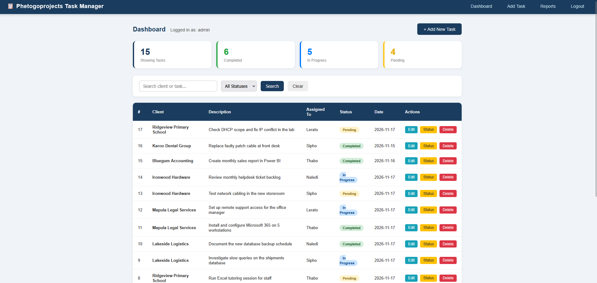

# Digital Task Management and Tracking System

A web application that replaces manual, whiteboard-based task tracking with a shared digital system. Built for **Phetogo Projects** as my Industry Project during my Work Integrated Learning (WIL) placement, and used by my mentor to manage real tasks.

**Live demo:** https://phetogoprojects.onrender.com




## The problem

Phetogoprojects tracked its tasks on a whiteboard. That meant no history, no clear ownership, no visible progress and no way to check status remotely. Tasks were easy to lose or overwrite, and managers had to ask people for updates instead of seeing them.

## The solution

A lightweight task tracker that lets a manager create and assign tasks, lets team members update them, and shows overall progress at a glance. It is designed to run on the company's **existing VMware infrastructure**, so it needs no extra hardware or paid services.

## Features

- Create, assign and update tasks
- Progress bar at the top of the page showing overall completion
- Separate **Admin** and **Manager** logins
- Data stored in a local SQLite database, so there is no separate database server to run
- Deployed as a live web app on Render

## Tech stack

| Layer | Technology |
|---|---|
| Backend | Python, Flask |
| Frontend | HTML (server-rendered templates) |
| Database | SQLite (`.db` file) |
| Hosting | Render |

## Getting started

### Prerequisites

- Python 3.9 or newer
- `pip`

### Run locally

```bash
# 1. Clone the repository
git clone https://github.com/<your-username>/<your-repo-name>.git
cd <your-repo-name>

# 2. Create and activate a virtual environment
python -m venv venv
source venv/bin/activate        # Windows: venv\Scripts\activate

# 3. Install dependencies
pip install -r requirements.txt

# 4. Start the app
python app.py
```

Then open **http://127.0.0.1:5000** in your browser.

> **Note:** adjust the file name in step 4 if your main file is not `app.py`.

### Configuration


## Analysis and planning documents

Before building the system, I carried out the business analysis and project planning for it:

- SWOT analysis
- AS-IS and TO-BE process maps
- Work Breakdown Structure (WBS)
- Gantt chart
- Risk register

## What I did

I was responsible for the whole project: analysing the existing manual process, proposing the digital system, planning the work, building the application, deploying it, and handing it over for real use.

## Author

**Siphesihle Baruza**
Diploma in Informatics, Tshwane University of Technology
Midrand, South Africa

